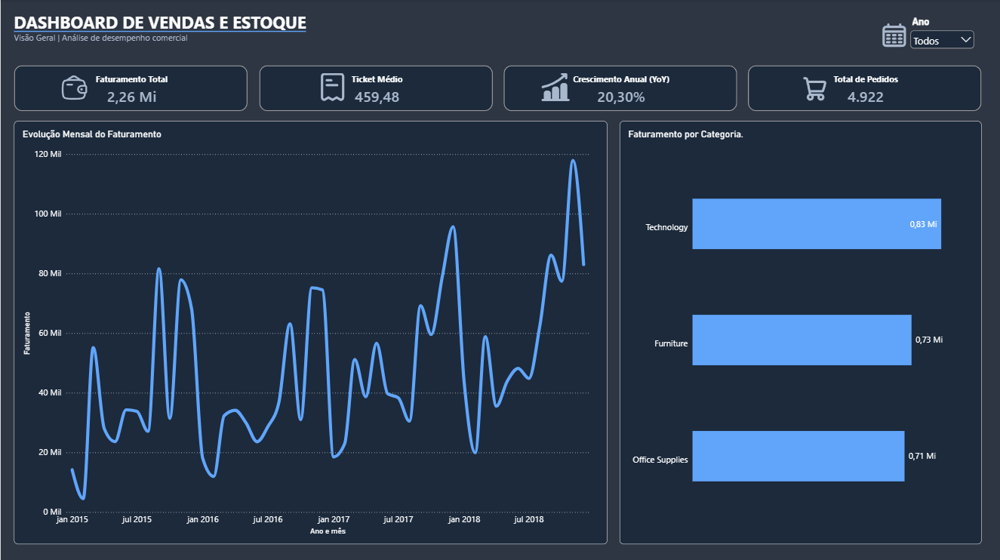
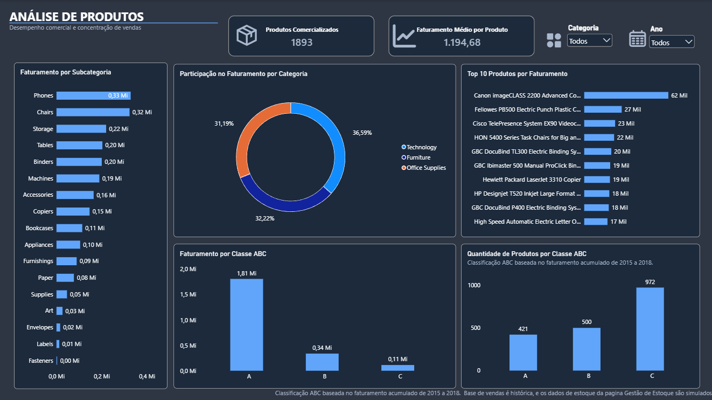
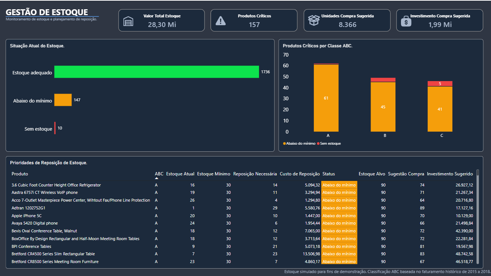

# Dashboard de Vendas e Estoque | Power BI + Python

Projeto de Business Intelligence desenvolvido para análise de desempenho comercial, classificação ABC de produtos e planejamento simulado de reposição de estoque.

O objetivo é transformar dados de vendas em informações gerenciais, utilizando Python para tratamento e preparação dos dados e Power BI para visualização e análise interativa.

## Visão geral do projeto

O dashboard está dividido em três páginas:

### 1. Visão Geral de Vendas

- Faturamento total e quantidade de pedidos.
- Ticket médio e crescimento anual (YoY).
- Evolução mensal do faturamento.
- Análise de faturamento por categoria.
- Filtros interativos por período.

### 2. Análise de Produtos

- Ranking dos dez produtos com maior faturamento.
- Faturamento por subcategoria.
- Participação das categorias na receita.
- Quantidade de produtos comercializados.
- Classificação ABC baseada no faturamento histórico.

### 3. Gestão de Estoque

- Monitoramento de estoque simulado.
- Identificação de produtos críticos.
- Análise de produtos críticos por classe ABC.
- Cálculo de reposição mínima.
- Sugestão de compra e investimento estimado.
- Tabela de prioridades de reposição.

## Tecnologias utilizadas

- **Python:** Pandas e NumPy.
- **Jupyter Notebook:** tratamento e validação dos dados.
- **Power BI:** dashboards e modelagem de dados.
- **DAX:** criação de indicadores e medidas.
- **Power Query:** importação e tipagem dos dados.
- **Markdown:** documentação técnica.

## Principais resultados

| Indicador | Resultado |
|---|---:|
| Registros de vendas | 9.800 |
| Pedidos distintos | 4.922 |
| Faturamento histórico | 2.261.536,78 |
| Produtos identificados | 1.893 |
| Produtos críticos (simulação) | 157 |
| Unidades de compra sugerida (simulação) | 8.366 |
| Investimento sugerido (simulação) | 1.993.248,63 |

## Tratamento e modelagem

O projeto inclui:

1. Identificação e correção de inconsistências em valores de vendas.
2. Validação dos dados com uma base pública de referência.
3. Tratamento de códigos associados a produtos diferentes.
4. Construção de um modelo dimensional com tabelas de fatos e dimensões.
5. Simulação de estoque e definição de níveis mínimos e alvos.
6. Classificação ABC com base no faturamento acumulado.
7. Desenvolvimento e validação de indicadores DAX.

## Fonte dos dados

Foi utilizada uma versão pública do conjunto de dados *Sample Superstore*, com registros de vendas entre 2015 e 2018.

Os dados de estoque foram gerados por simulação exclusivamente para fins educacionais e demonstração.

**Importante:** o projeto não representa a operação real de uma empresa. Os custos, saldos e recomendações de compra não devem ser interpretados como informações operacionais reais.

## Documentação

Para conhecer as etapas de preparação dos dados, modelagem e limitações, consulte [Documentação Técnica](DOCUMENTACAO_TECNICA.md).

## Autor

Projeto desenvolvido como parte de um portfólio profissional de análise de dados e Business Intelligence.