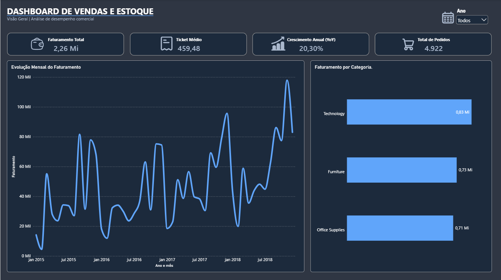
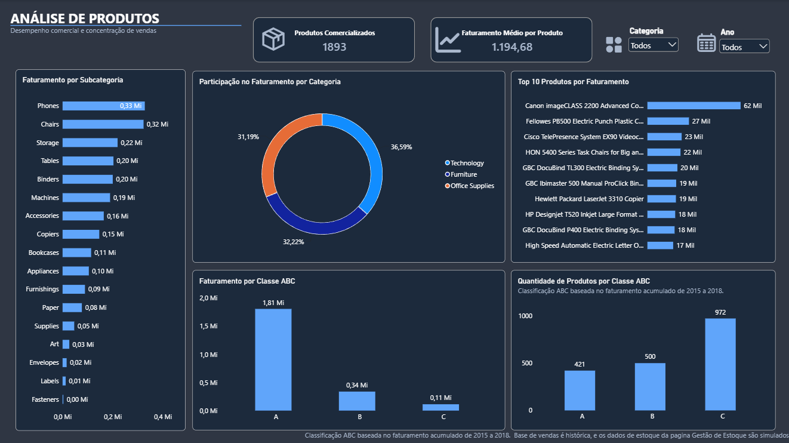
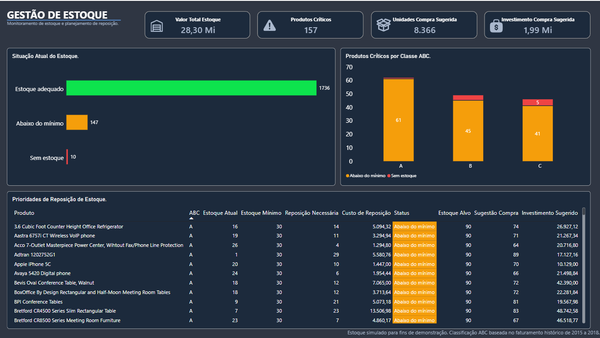

# Sales & Inventory Analytics Dashboard | Power BI + Python

🌐 **English** | [Português (Brasil)](README.pt-BR.md)

A Business Intelligence portfolio project focused on **sales performance analysis, product ABC classification, and simulated inventory replenishment planning**.

The project uses Python to prepare sales data and Power BI to build interactive reports that turn historical transactions into actionable business insights.

## Project Overview

The dashboard contains three report pages:

### 1. Sales Overview

- Total revenue and number of orders.
- Average order value and year-over-year (YoY) growth.
- Monthly revenue trends.
- Revenue by product category.
- Interactive date filters.

### 2. Product Analysis

- Top 10 products by revenue.
- Revenue by subcategory.
- Category contribution to total revenue.
- Number of products sold.
- ABC classification based on historical revenue.

### 3. Inventory Management (Simulation)

- Simulated inventory monitoring.
- Identification of critical stock items.
- Critical items by ABC class.
- Minimum replenishment calculations.
- Suggested purchase quantities and estimated investment.
- Replenishment priority table.

## Technology Stack

- **Python:** Pandas and NumPy for data preparation.
- **Jupyter Notebook:** data processing and validation.
- **Power BI:** interactive dashboards and data modeling.
- **DAX:** business measures and KPIs.
- **Power Query:** data import and type transformations.
- **Markdown:** technical documentation.

## Key Results

| Metric | Result |
|---|---:|
| Sales records | 9,800 |
| Distinct orders | 4,922 |
| Historical revenue (dataset units) | 2,261,536.78 |
| Identified products | 1,893 |
| Critical products (simulation) | 157 |
| Suggested purchase units (simulation) | 8,366 |
| Suggested investment (simulation, dataset units) | 1,993,248.63 |

*Monetary amounts are based on the source dataset and simulation; they are not real company financial results.*

## Data Preparation and Modeling

The project includes:

1. Identifying and correcting inconsistencies in sales values.
2. Validating data against a public reference dataset.
3. Resolving product identifiers associated with different products.
4. Building a dimensional model with fact and dimension tables.
5. Simulating inventory balances and defining minimum and target stock levels.
6. Performing ABC classification based on cumulative revenue.
7. Developing and validating DAX measures.

## Data Source and Limitations

The sales data comes from a public version of the **Sample Superstore** dataset, covering transactions from **2015 to 2018**.

**Inventory data is entirely simulated for educational and portfolio purposes.** The project does not represent a real company's operations. Inventory balances, costs, and replenishment recommendations must not be interpreted as actual operational figures.

## Documentation

- [Full README in Portuguese](README.pt-BR.md)
- [Technical Documentation (Portuguese)](DOCUMENTACAO_TECNICA.md)
- [Professional Case Study (Portuguese)](CASE_PROFISSIONAL.md)

## Author

**Guilherme Milani** — Data Analytics and Business Intelligence portfolio project.

[LinkedIn](https://www.linkedin.com/in/guilherme-milani-silva/) | [GitHub Profile](https://github.com/Guilherme-milani-27)
